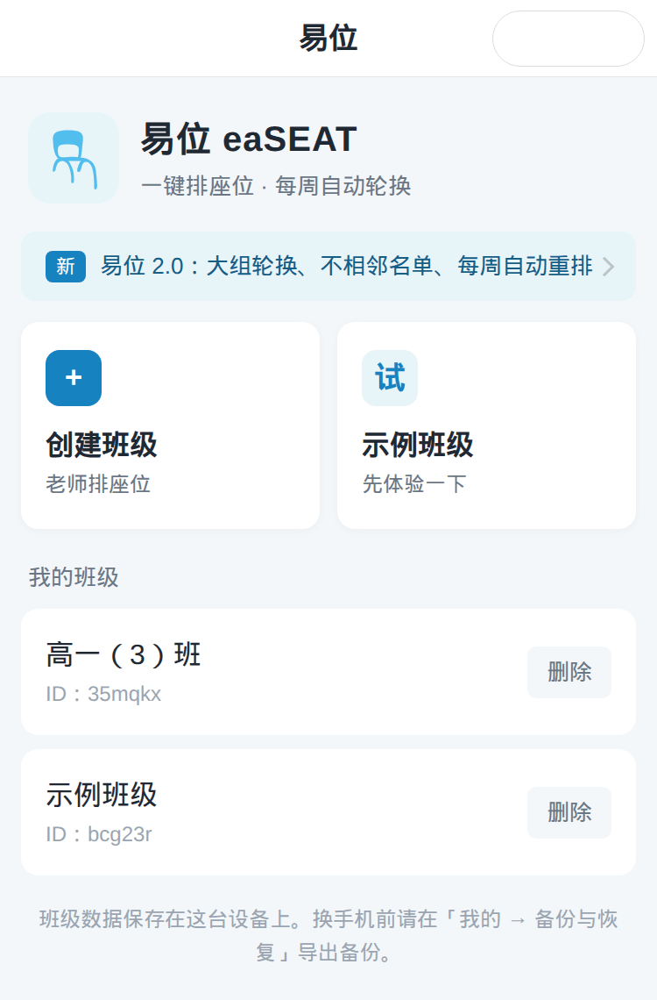

<p align="center"></p>

<h1 align="center">易位 eaSEAT</h1>

<p align="center">帮老师自动排座位的网页、微信小程序和 QQ 小程序<br>
<a href="https://surnamemei.github.io/Easeat/"><b>打开网页版</b></a> · <a href="https://github.com/surnamemei/Easeat/releases/tag/v1.0">1.0 原版存档</a></p>

> **English:** Easeat arranges classroom seats for teachers — by height, at random, or by rotating the seat groups every week — while keeping chosen pairs of students apart. It exports print-ready Excel files and images, and shares read-only links with students and parents. It runs as a website and as WeChat / QQ mini programs, all without a server: data stays on the teacher's device. The original QQ mini program was written by Wenbo Zhang; surnamemei ported it to WeChat and maintains it.

## 功能

| | |
| --- | --- |
| **三种排座方式** | 按身高（矮的在前，身高相近的同学随机换位）、完全随机、大组轮换（每组整体右移一组，同桌不变） |
| **不相邻名单** | 指定两位同学，排座时他们既不做同桌，也不坐前后桌 |
| **每周自动重排** | 每周一以后第一次打开班级时，按设置的方式自动换座位 |
| **手动调整** | 点一个座位再点另一个即可交换；可以直接修改座位上的姓名；可切换为讲台视角 |
| **学生名单** | 逐个添加、粘贴整段名单，或导入 Excel / CSV（自动识别标题行、表头和序号列） |
| **导出** | 可以直接打印的 Excel 文件（座位表 + 学生名单）、座位表图片、复制到 Excel / WPS 的表格 |
| **分享** | 复制只读的网页链接，学生和家长在浏览器里就能查看座位表 |
| **备份** | 所有班级导出成一个文件；网页版、微信版、QQ 版之间可以互相导入 |

<p align="center">



</p>

## 作者

易位最初是武汉英中高级中学学生的作品：

- **Wenbo Zhang** 开发了 QQ 小程序原版；
- **surnamemei** 把它移植到微信，并负责后续维护。

2.0 之前的代码保存在 [v1.0 存档](https://github.com/surnamemei/Easeat/releases/tag/v1.0) 中。

## 三种用法

| | 数据保存在 | 需要部署 |
| --- | --- | --- |
| [网页版](https://surnamemei.github.io/Easeat/) | 浏览器（localStorage） | 不需要，GitHub Pages 直接发布 `docs/` |
| 小程序 · 本机模式（默认） | 手机本地缓存 | 不需要云开发，没有任何费用 |
| 小程序 · 云端模式 | 微信 / QQ 云开发数据库 | 部署云函数 `easeat`；学生和家长可以加入班级、数据可以跨设备同步 |

三种用法运行的是同一份业务逻辑（`core/service.js`），功能完全相同；云端模式只是多了“加入班级”。切换模式只需修改 `utils/platform.js` 里的 `mode`。

## 项目结构

```
core/                      共用代码（唯一的源文件），由 scripts/sync.js 复制到下面三个地方
  service.js               全部业务逻辑：班级、名单、布局、排座、备份
  arrange.js               排座算法（纯函数）
  roster.js                名单解析（粘贴的文字、表格的行）
  seat-chart.js            座位表的显示数据、图片绘制、Excel 工作表
  xlsx.js                  读写 .xlsx / .csv，不需要服务器
  share-link.js            只读的座位表链接（数据压缩后放进网址）
  local-db.js              本机数据库：实现云数据库接口的一部分，数据存在手机或浏览器里
  demo.js                  示例班级
  fflate.js                zip 压缩库（MIT 许可，第三方代码）
Easeat-wx/                 微信小程序（以它为准）
  pages/                   首页、班级页、备份与恢复、我的、教程、公告、关于、反馈
  components/input-dialog/ 带输入框的对话框
  utils/                   api.js（本机 / 云端）、files.js（导出和读取文件）、platform.js、core/（复制来的）
  cloudfunctions/easeat/   云函数（只有云端模式需要）
Easeat-qq/                 QQ 小程序，由 scripts/sync.js 生成（utils/platform.js 和 project.config.json 除外）
docs/                      网页版（GitHub Pages）：index.html、app.css、js/app.js、js/core/（复制来的）
scripts/sync.js            同步共用代码并生成 QQ 版
tests/                     自动化测试
```

修改共用逻辑时改 `core/`，修改小程序界面时改 `Easeat-wx/`，然后运行 `npm run sync`。

## 小程序：本机模式（默认）

1. 用微信开发者工具打开 `Easeat-wx`（QQ 版用 QQ 小程序开发者工具打开 `Easeat-qq`），直接编译即可，不需要开通云开发。
2. 在小程序管理后台的「用户隐私保护指引」中声明「剪切板」（复制表格、链接、备份）和「选中的文件」（导入名单、恢复备份），否则这两类功能会被拦截。
3. 发布前请确认小程序已经完成 ICP 备案：2024 年 4 月起，没有备案的小程序无法上架或会被清退。

本机模式下：

- 数据只保存在这台设备上，换手机或删除小程序前请在「我的 → 备份与恢复」导出备份；
- 没有“加入班级”，座位表通过图片、Excel 文件或网页链接分享；
- 每周自动重排在每周一以后第一次打开班级时进行。

## 小程序：云端模式

1. 把 `utils/platform.js` 中的 `mode` 改为 `'cloud'`，`cloudEnv` 改为你的云开发环境 ID。
2. **数据库**：创建 `class`、`classStudent`、`classUser`、`classSeat`、`classArrangement` 五个集合（1.0 时已经建好的可以直接使用），权限都设为「所有用户不可读写」，云函数不受影响。
3. **云函数**：右键 `cloudfunctions/easeat` →「上传并部署：云端安装依赖」，并在控制台把超时时间改为 20 秒。
4. **定时触发器**：右键 `cloudfunctions/easeat/config.json` →「上传触发器」（每周一 06:00，北京时间）。
5. 1.0 的旧云函数（`addStudent`、`addStudentByFile`、`changeData`、`createClass`、`deleteClass`、`deleteStudent`、`getArrangement`、`getClassList`、`getSeat`、`getStudents`、`joinClass`、`notice`、`quitClass`、`rearrangeSeat`、`setSeat`）没有权限检查，请删除。

## 开发

需要 Node.js 18 或更高版本，不需要安装任何依赖。

```bash
npm test
```

```bash
npm run sync
```

`npm test` 会运行：

- 排座算法、名单解析、Excel 读写（包括用 openpyxl 生成的测试文件）、分享链接的测试；
- 业务逻辑的每个操作，包括权限检查、旧版本数据的兼容、备份和恢复；
- 页面测试：在 Node 里模拟小程序运行环境，像用户一样点击页面。微信版和 QQ 版各跑一遍，每个平台又分本机模式和云端模式；
- 检查 QQ 版、云函数和网页版里的 core 副本是否已经同步。

真机上的效果（文件转发、生成图片等）还需要在微信和 QQ 开发者工具或手机上检查。

## 数据结构

每个班级在五个集合里各有一条记录，`_id` 都是班级 ID（6 位小写字母数字）。本机模式和网页版使用同样的结构，只是存在本地。

| 集合 | 字段 |
| --- | --- |
| `class` | `owner`、`name`、`createdAt`、`settings: { mode, autoWeekly, separate }` |
| `classStudent` | `students: [{ id, name, height }]`、`studentIdTop` |
| `classUser` | `members`：加入班级的用户（只有云端模式使用） |
| `classSeat` | `seats`：二维布尔数组，`true` 表示有课桌，第 0 排离讲台最近 |
| `classArrangement` | `arrangement`：与 `seats` 同形状，`null` 为没有课桌，`''` 为空课桌；`arrangedAt`、`arrangedBy`（`manual` / `auto`） |

备份文件是一个 JSON：`{ app: 'easeat', version: 1, exportedAt, classes: [{ name, settings, students, seats, arrangement, arrangedAt, ... }] }`。

## 业务接口

`core/service.js` 的 `call(action, data, openid)` 返回 `{ ok: true, data }` 或 `{ ok: false, msg }`。云端模式通过云函数 `easeat` 调用（`data.action` 为操作名），本机模式和网页版直接调用。

| action | 说明 |
| --- | --- |
| `listClasses` | 我创建的和我加入的班级 |
| `createClass` `{ name }` / `deleteClass` `{ classId }` | 创建 / 删除班级 |
| `joinClass` / `quitClass` `{ classId }` | 加入 / 退出班级（云端模式） |
| `getClass` `{ classId }` | 班级详情；名单和设置只返回给创建者 |
| `updateClass` `{ classId, name?, settings? }` | 改名、排座方式、每周自动重排、不相邻名单 |
| `addStudents` `{ classId, students \| text \| rows }` / `deleteStudent` `{ classId, studentId }` | 添加 / 删除学生 |
| `saveLayout` `{ classId, seats }` | 保存教室布局（尽量保留原座位） |
| `arrange` `{ classId, mode }` | 排座 |
| `swapSeats` `{ classId, a, b }` / `setSeatName` `{ classId, row, col, name }` | 手动调整座位 |
| `exportData` / `importData` `{ backup }` | 备份 / 恢复 |

## 隐私

- 本机模式和网页版的数据只保存在设备上，不会上传；导入的 Excel 在设备上读取。
- 网页链接里包含座位表上的姓名，请只发给需要的人。
- 仓库里不包含任何数据库导出（`.gitignore` 排除了 `database/`），其中有用户的 openid 和学生姓名，请不要提交到公开仓库。

问题和建议请提交到 [GitHub Issues](https://github.com/surnamemei/Easeat/issues)。
